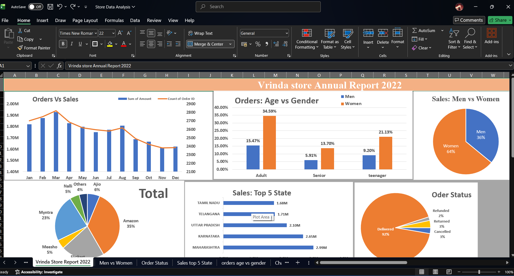

# Vrinda Store Annual Sales Analysis (2022)

An end-to-end Excel analysis of **31,000+ sales records** from Vrinda Store in 2022. The project finds out who the store's customers are, where its sales come from, and where revenue can grow in 2023.

---

## Business problem

Vrinda Store wanted to understand its 2022 sales to plan better marketing for 2023.

Questions this project answers:
1. Who buys the most (gender and age group)?
2. Which sales channels and states bring the most revenue?
3. How many orders are delivered, and how many are cancelled, returned or refunded?
4. Which months are the busiest?

---

## Dashboard preview

---

## Key insights

| Area | Finding |
| :--- | :--- |
| **Sales trend** | Sales peaked in **March (about ₹1.92M)** with over **2,800 orders**, then trended down towards the end of the year. |
| **Gender** | **Women contribute 64%** of sales and men 36%. |
| **Age and gender** | **Adult women (30–49) are the largest segment at 34.59%** of orders, followed by teenage women (21.13%) and adult men (15.47%). Seniors are the smallest group. |
| **Sales channels** | **Amazon (35%)** and **Myntra (23%)** bring nearly **60%** of total orders. Ajio (6%), Meesho (5%) and Nalli (5%) are smaller channels. |
| **Top states** | **Maharashtra (₹2.99M)**, **Karnataka (₹2.65M)** and **Uttar Pradesh (₹2.10M)** lead revenue, followed by Telangana (₹1.71M) and Tamil Nadu (₹1.68M). |
| **Order status** | **92%** of orders were delivered. Returned (3%), cancelled (3%) and refunded (2%) orders make up the other **8%**. |

---

## Recommendations

These suggestions are based on the findings above.

- **Target the biggest buyers:** Focus campaigns on women aged 30–49 in Maharashtra, Karnataka and Uttar Pradesh.
- **Strengthen top channels:** Amazon and Myntra drive most orders, so deals and listings there matter most. Smaller channels can be tested for growth.
- **Plan for the peak:** Keep enough stock and run offers around March, and study why sales fell in later months.
- **Reduce lost orders:** Look into the 8% of cancelled, returned and refunded orders to find common reasons.

---

## What I did

- **Data preparation:** Cleaned the raw sales data and added an `Age Group` column (Teenager, Adult, Senior).
- **Analysis:** Built pivot tables to summarise sales by month, gender, age group, channel, state and order status.
- **Visualisation:** Designed a single-page Excel dashboard with combo, bar and pie charts.
- **Excel features used:** Pivot tables, calculated columns, charts, formatting.

---

## Files in this repository

| File | Description |
| :--- | :--- |
| `Store Data Analysis.xlsx` | Excel workbook with the data, pivot tables and dashboard |
| `dashboard_screenshot.png` | Preview image of the dashboard |
| `README.md` | Project documentation |

---

## About me

**Satyam Mishra**, B.Tech CSE (AI) student and aspiring Data Analyst.

- LinkedIn: [satyammishraaa](https://www.linkedin.com/in/satyammishraaa/)
- GitHub: [satyammishra19](https://github.com/satyammishra19)
- Email: mishrasatyam1912@gmail.com
